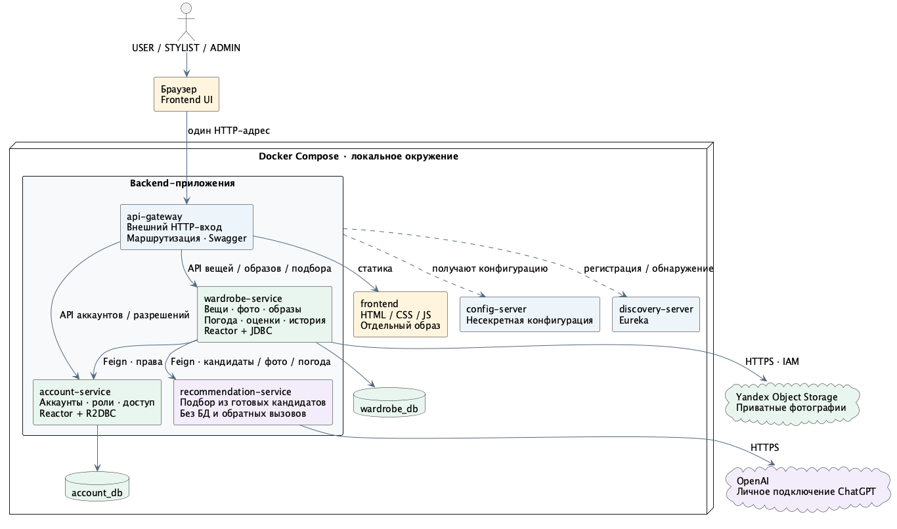
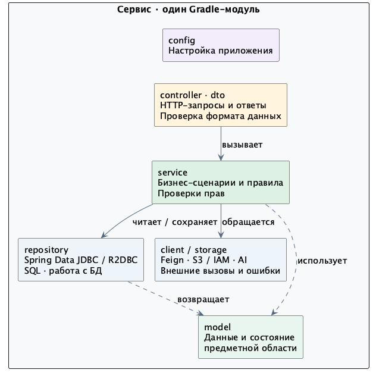
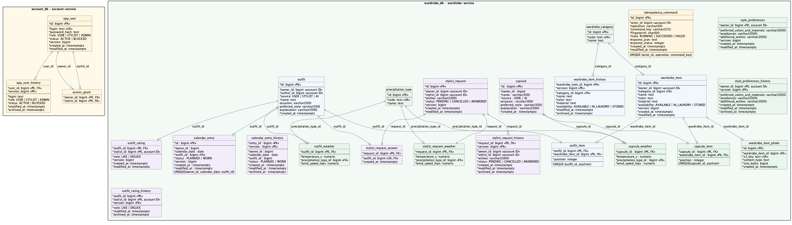
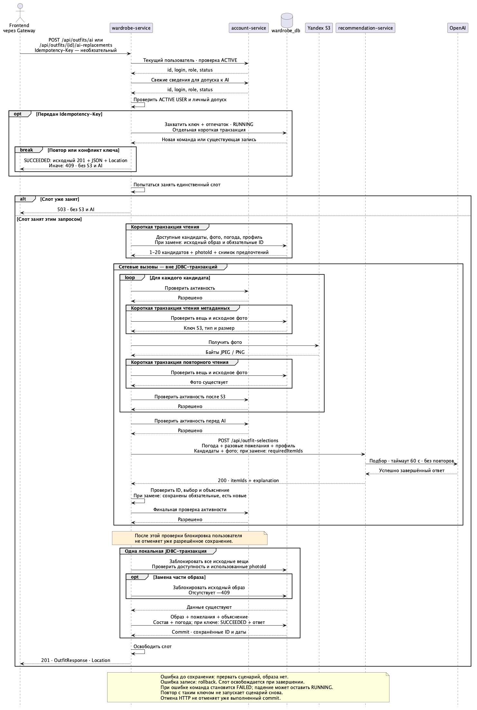

# Архитектура ЛР2

Целевая система для перехода от монолита ЛР1 к микросервисам. На этапе 01 меняется только документация; приложение пока остаётся монолитом. Контракты и сценарии проверок описаны в [contracts.md](contracts.md).

## Компоненты

| Компонент | Ответственность | Технологии и данные |
|---|---|---|
| account-service | Пользователи, их история, роли, статусы, разрешения стилистам | Kotlin, WebFlux/Reactor, Spring Data R2DBC, account_db |
| wardrobe-service | Вещи, фото, образы, погода, оценки и история; подготовка и сохранение AI-образа | Kotlin, WebFlux/Reactor, Spring Data JDBC, wardrobe_db, Yandex Object Storage |
| recommendation-service | Выбор вещей из переданных кандидатов и изображений | Kotlin, WebFlux/Reactor, текущий AI-клиент; без собственной БД |
| frontend | Текущий интерфейс USER/STYLIST/ADMIN | HTML/CSS/JS, отдельная сборка и образ со статическим web-сервером |
| api-gateway | Единственный внешний HTTP-вход, маршрутизация UI/API, общий Swagger | Spring Cloud Gateway |
| discovery-server | Регистрация и обнаружение backend-сервисов | Eureka |
| config-server | Несекретная конфигурация backend-приложений | Spring Cloud Config Server |

Браузер получает статику и вызывает API через один адрес Gateway. Frontend не содержит бизнес-API и не обращается прямо к сервисам. Gateway не проверяет бизнес-права и не работает с БД. Внутренние порты не публикуются на хост по умолчанию.

Wardrobe обращается через Feign к account за текущими правами и к recommendation за подбором. Recommendation получает готовые данные: не читает account_db, wardrobe_db или S3, не вызывает wardrobe обратно и не сохраняет образы. Межсервисные клиенты используют Circuit Breaker, без разрешающего fallback и автоматических повторов изменяющих операций/AI.

Config Server доступен по фиксированному адресу Compose и не зависит от Eureka для первоначального запуска. Бизнес-сервисы и Gateway получают конфигурацию и используют Eureka; frontend в Eureka не регистрируется. Вся система запускается одним `docker compose up --build`.

## Устройство сервиса

Один Gradle-модуль на сервис. Пакеты: `controller`, `service`, `repository`, `model`, `dto`, `client`, `storage`, `config`; внутри технического слоя — предметная область, например `service.wardrobe`. Ненужные пакеты не создаются.

- Controller принимает HTTP-данные, проверяет их формат, вызывает сервис и формирует ответ.
- Service отвечает за бизнес-правила, права и координацию сценария. SQL, HTTP-ответы и детали протоколов внешних систем остаются вне него.
- Repository выполняет запросы и маппинг БД. Client/storage инкапсулируют транспорт, авторизацию внешней системы и технические ошибки.
- Model отражает данные предметной области, DTO — передаваемые данные, config — настройку приложения.

Spring-аннотации и маппинг Spring Data допустимы. Отдельные core/runtime, обязательные порты, дублирующие модели и интерфейсы-обёртки не вводятся. Составное создание вещи с фото остаётся ответственностью WardrobeManagementService, простые операции — соответствующих сервисов. Общего JAR бизнес-моделей между сервисами нет.

В account транзакции выполняются через R2DBC. В wardrobe каждый JDBC-транзакционный участок целиком выполняется на одном ограниченном worker-потоке. JDBC, Feign, S3/IAM и блокирующий AI-клиент не работают на event loop. Сетевые вызовы не входят в транзакции БД.

## Владение данными

| БД | Таблица | Назначение |
|---|---|---|
| account_db | app_user | Аккаунт, роль, статус, версия и технические даты |
| account_db | app_user_history | Предыдущие состояния аккаунта, без password_hash |
| account_db | access_grant | Разрешение owner → stylist |
| wardrobe_db | wardrobe_category | Категории вещей |
| wardrobe_db | wardrobe_item | Карточка вещи и владелец |
| wardrobe_db | wardrobe_item_history | Предыдущие и последние удалённые версии вещей |
| wardrobe_db | wardrobe_item_photo | Метаданные фото и ключ приватного объекта S3 |
| wardrobe_db | precipitation_type | Виды осадков |
| wardrobe_db | outfit | Неизменяемый образ: владелец, автор, источник, название |
| wardrobe_db | outfit_item | Состав образа и порядок вещей |
| wardrobe_db | outfit_weather | Погодные условия, сохранённые с образом |
| wardrobe_db | outfit_rating | Текущий голос стилиста |
| wardrobe_db | outfit_rating_history | История изменений, отмены и удаления текущих голосов |

Это все прикладные таблицы монолита после V1–V10; служебная история Flyway ведётся отдельно в каждой БД. Роли/статусы, источник образа и голос остаются строковыми PostgreSQL enum. Файлы живут в S3, а не в PostgreSQL.

Межсервисные ссылки — `wardrobe_item.owner_id`, `outfit.owner_id/author_id`, `outfit_rating.stylist_id` и `outfit_rating_history.stylist_id`. Значения ID сохраняются, но FK на app_user в wardrobe_db нет. Существование и доступ проверяются через account; локальные FK внутри каждой БД остаются. Удаление аккаунтов не добавляется, роли и статусы могут меняться без переписывания авторства и истории.

У истории вещи нет FK на удаляемую вещь; у истории оценки нет FK на удаляемый образ. Эти особенности сохраняются. Категория в истории вещи и пользователь в истории аккаунта имеют локальные FK. Создание истории и изменение основной записи остаются атомарными.

`created_at`, `modified_at` и `archived_at` формирует PostgreSQL: DEFAULT/явный CURRENT_TIMESTAMP в SQL, без триггеров. История копирует прежний modified_at; archived_at получает время архивирования. Порядок версий определяет version, а не сравнение дат.

Переход выполняется позднее, с остановкой записей и резервной копией: перенести account-таблицы с прежними ID/датами/версиями и sequences, сверить данные, переключить единственного писателя и проверки доступа, снять только межсервисные FK. Не вводятся dual-write, общие таблицы и чтение чужой БД. Старые миграции и данные на этапе 01 не меняются.

## Доступ и ограничения

ЛР2 остаётся локальной доверенной демонстрацией. `X-User-Id` выбирает пользователя, но не подтверждает его личность. Возврат Spring Security/JWT и публичный хостинг не входят в эту работу. Бизнес-проверки ролей и разрешений сохраняются; новые ограничения собственных API только по роли USER не вводятся.

Перед локальной транзакцией wardrobe получает свежее решение account, без кэша разрешений. Ошибка account не разрешает операцию. Если доступ отозвали после успешной проверки, операция может завершиться, даже если ожидала блокировку строки. Это согласованное изменение гарантии монолита, а не распределённая атомарность. Для скачивания фото остаются проверки доступа и существования метаданных после S3, перед выдачей.

Фото: максимум пять на вещь, ранняя проверка свободных мест до S3 и окончательная под блокировкой. Создание вещи и всех метаданных атомарно, загрузка файлов — до транзакции. Удаление метаданных не удаляет файлы S3. Возможные объекты без метаданных при гонке/сбое остаются известным ограничением; очистка не добавляется.

Образ неизменяем; новый состав — новый образ. Используемую в образе вещь удалить нельзя. Удаление образа архивирует текущие голоса и удаляет состав, погоду и текущие оценки; история оценок остаётся. Отзыв доступа не удаляет ранее поставленные голоса и не меняет счётчики.

## AI-подбор и секреты

Публичный `POST /api/outfits/ai` обслуживает wardrobe. Он подготавливает кандидатов и фото, вызывает recommendation, проверяет выбранные ID и сохраняет образ одной локальной транзакцией. При отказе AI или ошибке до сохранения образ не создаётся; ошибка транзакции приводит к rollback.

Сохраняются 1–20 кандидатов после исключения вещей без фото, по одной фотографии до 10 000 000 байт на вещь. Одновременно выполняется один подбор на экземпляр wardrobe; слот захватывается до загрузки фото и удерживается до завершения сценария. Очереди нет, занятость даёт 503 без S3/AI-вызовов. Локальный Compose запускает один экземпляр; кластерный ограничитель не добавляется.

ChatGPT credentials, модель и отдельный trust store доступны только recommendation. Проверка разрешённого владельца личного подключения остаётся в wardrobe. Ключ сервисного аккаунта Яндекса и автоматическое обновление IAM-токена — только в wardrobe. Frontend и Config Server не получают секреты. Подписка не становится общим ресурсом публичного сервиса; платный fallback не добавляется.

## Версии и соответствие заданию

Kotlin 2.3.21, Java 25, Spring Boot 4.1.1 и springdoc 3.1.1 сохраняются. Для подключения Spring Cloud выбран BOM 2025.1.3: [официальная матрица](https://spring.io/projects/spring-cloud/) поддерживает Boot 4.1.x начиная с Cloud 2025.1.2. Reactor, Spring Data и R2DBC-драйвер подключаются через управление зависимостями Boot/Cloud, без независимого подбора версий. На этом этапе build.gradle.kts не изменяется.

| Требование [ЛР2](https://github.com/Discipliny/highload_systems#лабораторная-работа-2) | Решение |
|---|---|
| Декомпозиция монолита | Три бизнес-сервиса, отдельные БД и frontend |
| Eureka / Config Server / Gateway | discovery-server / config-server / api-gateway |
| Feign / Circuit Breaker | Вызовы wardrobe → account/recommendation |
| Reactor + R2DBC | account-service |
| Reactor + Spring Data JDBC | wardrobe-service |

Сохраняются общий Swagger, запуск Compose и общий порог покрытия 70%. Kafka, отдельный файловый сервис, новая авторизация и переписывание frontend не включаются заранее. Согласование модели данных с преподавателем — отдельная проверка.

Документы ЛР1 остаются в [requirements.md](../requirements.md), [architecture.puml](../architecture.puml) и [domain.puml](../domain.puml). Основание для данных — [миграции](../../wardrobe-service/src/main/resources/db/migration); для API — [контроллеры](../../wardrobe-service/src/main/kotlin/ru/itmo/clothesadvisor/controller).
