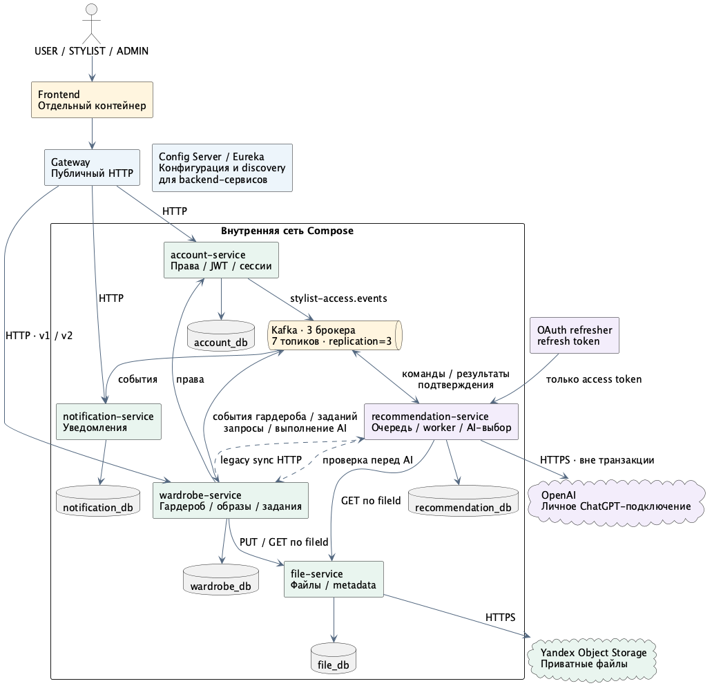
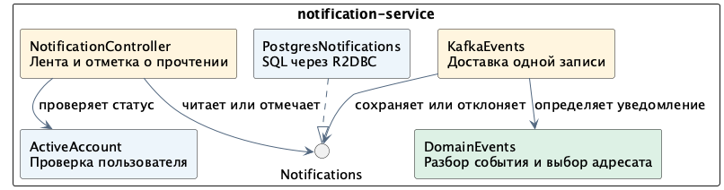

# Архитектура ЛР4

Согласовано 6 ноября 2026. Здесь описана целевая система; код, зависимости и миграции на этом этапе не меняются. Контракты: [HTTP](api.md), [сообщения](messaging.md), [данные](data.md), [проверки](acceptance.md).

## Что меняется

Длительный AI-подбор выполняется через Kafka. Wardrobe принимает задание и сохраняет готовый образ или капсулу; recommendation получает собственную БД заданий и выполняет выбор вещей. Файлы обслуживает отдельный file-service. Notification-service принимает события и хранит уведомления для интерфейса.

| Компонент | Владелец ответственности | Доступ к данным |
| --- | --- | --- |
| account-service | Аккаунты, JWT-сессии, роли, разрешения стилистам | Существующая account_db, R2DBC |
| wardrobe-service | Вещи, связи фото, образы, капсулы, календарь, запросы стилистам, AI-задания | Существующая wardrobe_db, Spring Data JDBC |
| recommendation-service | Очередь исполнения, выбор вещей, снимок промпта, результат AI | Новая recommendation_db, R2DBC |
| file-service | Неизменяемые файлы, технические метаданные, Yandex Object Storage | Новая file_db, R2DBC |
| notification-service | Уведомления, получатели и прочтение | Новая notification_db, R2DBC |
| Gateway / frontend | Публичный HTTP-вход, интерфейс и наблюдение за заданиями | Прямого доступа к БД и Kafka нет |
| Config Server / Eureka | Конфигурация и обнаружение сервисов | Существующая инфраструктура |

## Согласованные границы

- Изменённые публичные AI-контракты находятся в `/api/v2`. Прежние адреса сохраняют синхронные ответы `201`. Новые POST возвращают `202` и задание.
- Таблица `idempotency_command` wardrobe, её уникальность и бессрочная дедупликация сохраняются. Новые таблицы AI-заданий и outbox разрешены.
- Recommendation хранит полный семантический `input` в JSONB без `payload_hash`. Повтор сравнивается в Kotlin. Идентичность операции — исходный календарный месяц UTC и внутренний request ID.
- Пользователь разрешил один обратный запрос recommendation → wardrobe после скачивания фото, перед OpenAI. Он проверяет актуальные права и исходные данные. Итог повторно проверяется перед сохранением в wardrobe.
- Образы остаются неизменяемыми; замена создаёт новый образ. Версии, история, лимиты вещей/фотографий и политика сохранения файлов после удаления метаданных не меняются.
- Используется личное подключение ChatGPT, доступное его текущему владельцу USER. Автоматического перехода на платный API и генерации изображений нет.

## Взаимодействия

Kafka используется для AI-команд, состояний и результатов, подтверждений применения и уведомлений. Семь предметных топиков: `stylist-access.events`, `stylist-requests.events`, `stylist-outfits.events`, `outfit-ratings.events`, `ai-jobs.events`, `ai-selection.requests`, `ai-selection.execution-events`. Три брокера KRaft, репликация 3, `min.insync.replicas=2`, producer `acks=all`. Это стенд на одном хосте: отказ хоста остаётся общим отказом.

HTTP остаётся для чтения данных, проверки прав, файлов и совместимости старых AI-клиентов. Ни один сервис не читает чужую БД. Подтверждение Kafka следует локальному commit; outbox допускает повторную доставку с тем же event ID.

Recommendation скачивает файлы своего сохранённого задания, проверяет вход через wardrobe и вызывает OpenAI без открытой БД-транзакции. Успех AI ещё не означает готовый образ: wardrobe должен атомарно сохранить ресурс, состояние задания и событие завершения. Неопределённый исход внешнего вызова не повторяется автоматически.

Старый HTTP-сценарий recommendation сохраняется как синхронный адаптер к тому же выбору вещей и тому же постоянному слоту исполнения. Он не создаёт отдельного AI-клиента или независимого лимита. При занятом слоте либо готовой фоновой работе, уже сохранённой в recommendation, новый синхронный вызов получает прежний `503`, без постановки в очередь. Недоставленный outbox wardrobe ещё не виден этому решению; строгого общего FIFO с момента HTTP-приёма не обещаем. Готовые старые ответы идемпотентности возвращаются без захвата слота.

## Слои и безопасность

Внутренний сценарий `file-service` перед загрузкой проверяет размер одной фотографии, тип JPEG/PNG по заголовку и соответствие заявленному MIME. Допустимый размер — от 1 до 10 000 000 байт. При скачивании адаптер различает полностью полученный ответ S3 `404` и ошибку передачи. Обрыв тела, превышение лимита ответа или таймаут возвращаются вызывающему коду как недоступность хранилища.

File-service принимает внутренние PUT/GET по `fileId` со служебной аутентификацией HTTP Basic. Метаданные записываются в собственную PostgreSQL через R2DBC. Для каждой попытки PUT сервис создаёт отдельный ключ объекта S3. Если две загрузки проходят одновременно, уникальность `file_id` в БД определяет, какие байты будут доступны при GET. Объект проигравшей попытки может остаться в S3. Принадлежность фотографии вещи и доступ пользователя проверяет wardrobe. Его переключение на файловый API запланировано на этап 05.

Один Gradle-модуль на сервис; технические пакеты с предметными подпакетами. Контроллеры и Kafka-listeners переводят транспортные DTO в запрос сценария. Сервисы определяют бизнес-решения; repository/client/storage скрывают SQL, брокер, HTTP и S3. Интерфейсы нужны на границах внешних зависимостей, а не для каждого класса. Отдельные core/runtime-модули не вводятся.

В recommendation сценарий `ItemSelectionService` использует `ItemSelectionProvider`, реализованный клиентом OpenAI. Цель подбора и причины ошибок находятся в модели; HTTP-статусы и коды ответа назначает контроллер. Аналогично причины отказа при проверке фотографий wardrobe преобразуются в HTTP-ответ в `WardrobeItemExceptionHandler`.

Текущий вход синхронного подбора содержит подготовленные изображения и не используется как сохраняемый input или сообщение Kafka. Для фоновых заданий предусмотрен отдельный контракт со ссылками на файлы. Доступ wardrobe к S3 заменяется при подключении файлового сервиса; промежуточный адаптер вокруг прежних S3-ключей не вводится.

JDBC-транзакция wardrobe целиком выполняется вне event loop на выделенном boundedElastic-пути. R2DBC-сценарии остаются реактивными. Сетевой вызов не удерживает локальную транзакцию; предварительное разрешение не отменяет финальную проверку данных.

Снаружи доступны только Gateway и защищённая конфигурацией Eureka; backend, БД и Kafka остаются во внутренних Compose-сетях. Пользовательские API проверяют JWT и текущие права. File-service и новый обратный API принимают отдельные сервисные credentials, не пользовательский JWT; Gateway эти маршруты не публикует. Владение Docker-хостом не входит в эту границу доверия.

Kafka ACL разделяет публикацию и чтение по сервисам/топикам. Несекретные параметры находятся в каталогах Config Server, секреты — в существующем механизме секретов окружения. OAuth refresh token остаётся только у refresher, access token — у recommendation; файлы и credentials не передаются в сообщениях.

## Согласованные параметры

Параметры подтверждены вместе с первым этапом:

| Решение | Значение |
| --- | --- |
| Очередь | До 5 незавершённых фоновых заданий, один активный вызов на личное подключение, до 15 минут до начала OpenAI |
| Неизвестный исход | `UNKNOWN`, пауза подключения до ручного возобновления, без повтора того же задания |
| Хранение recommendation | Текущий месяц и три предыдущих; удаление только после безопасного закрытия, без S3-архива на первом шаге |
| Ключ между версиями | Общая область бизнес-операции; сохранённый успех другой версии возвращает `409` |
| Фиксация входа | Данные пользователя при принятии; промпт и модель перед первым выполнением |
| Файлы / уведомления | HTTP-контракты и схема из соседних документов |

## Основания

Исходный код исследован на `lab3`, `efb64b4cdf27ec9e1a79c3f24e7492c8e51de654`. Ключевые файлы: [AI-сценарий](../../wardrobe-service/src/main/kotlin/ru/itmo/clothesadvisor/service/ai/AiSelectionService.kt), [идемпотентность](../../wardrobe-service/src/main/kotlin/ru/itmo/clothesadvisor/service/idempotency/IdempotencyService.kt), [фотографии](../../wardrobe-service/src/main/kotlin/ru/itmo/clothesadvisor/service/wardrobe/WardrobeItemPhotoService.kt), [AI-клиент](../../recommendation-service/src/main/kotlin/ru/itmo/clothesadvisor/client/ai/OpenAiSelectionClient.kt).

Требования: [ЛР4](https://github.com/Discipliny/highload_systems#лабораторная-работа-4). Гарантии доставки: [Kafka](https://kafka.apache.org/41/design/design/#message-delivery-semantics). Публикация после локального commit: [transactional outbox](https://spring.io/blog/2023/10/24/a-use-case-for-transactions-adapting-to-transactional-outbox-pattern/).
