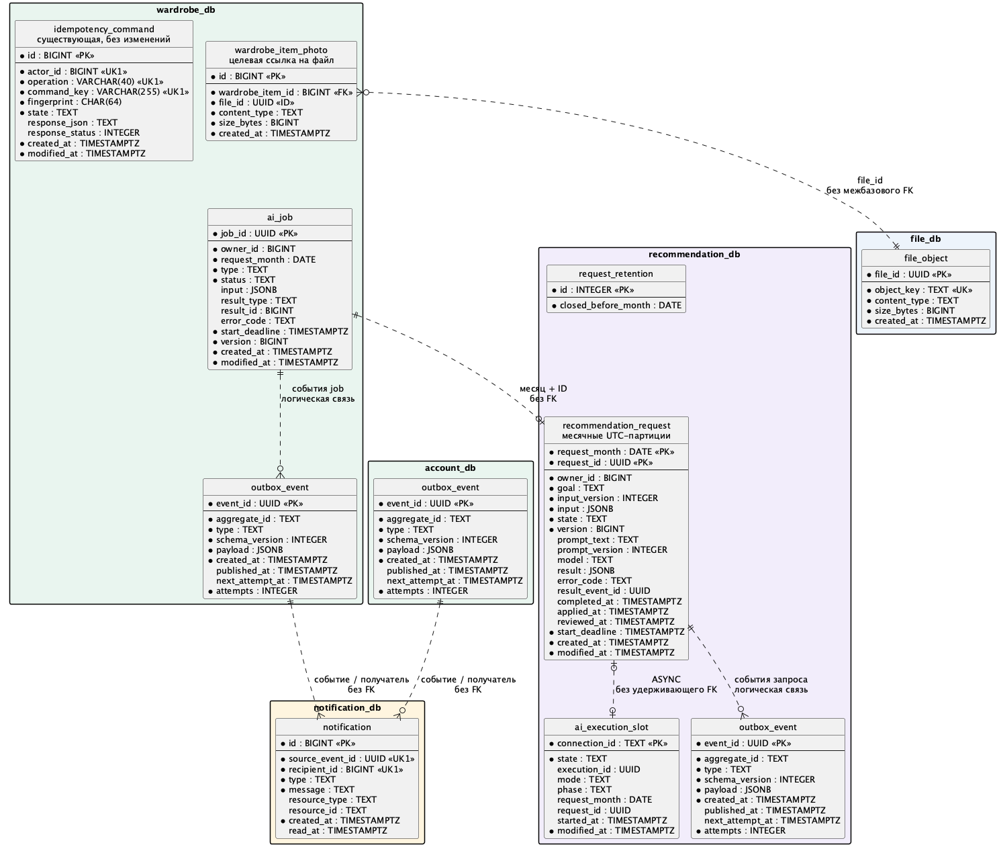

# Данные и хранение ЛР4

Согласованная целевая модель; SQL-миграции выполняются на следующих этапах. Между БД нет FK и общих таблиц; внешний ID проверяется сервисом-владельцем. Технические created_at/modified_at формирует PostgreSQL; версии и состояния определяют порядок изменений.

## Существующие данные

| БД | Активные таблицы, сохраняющие владельца |
| --- | --- |
| account_db | app_user, app_user_history, access_grant, auth_session, auth_refresh_token |
| wardrobe_db: гардероб | wardrobe_category, wardrobe_item, wardrobe_item_history, wardrobe_item_photo |
| wardrobe_db: образы | precipitation_type, outfit, outfit_item, outfit_weather, outfit_rating, outfit_rating_history |
| wardrobe_db: предпочтения | style_preferences, style_preferences_history |
| wardrobe_db: стилист | stylist_request, stylist_request_weather, stylist_request_history, stylist_request_answer |
| wardrobe_db: календарь/капсулы | calendar_entry, calendar_entry_history, capsule, capsule_item, capsule_weather |
| wardrobe_db: идемпотентность | idempotency_command — без изменения схемы и партиционирования |

Физические legacy app_user/app_user_history/access_grant в wardrobe после ЛР2 не используются и этим этапом не удаляются. Flyway ведёт служебную историю отдельно в каждой БД. Это описание учитывает [сессии ЛР3](../../account-service/src/main/resources/db/migration/V3__create_auth_sessions.sql) и [погоду AI-капсулы](../../wardrobe-service/src/main/resources/db/migration/V21__create_ai_capsules.sql), отсутствующие в ранней ER ЛР2.

## Новые сущности

| БД / таблица | Содержание и ключевые ограничения |
| --- | --- |
| wardrobe.ai_job | UUID job_id; owner_id; type; request_month; исходный input JSONB; status; result_type/result_id либо error_code; start_deadline; version; даты. job_id является внутренним request_id. |
| account/wardrobe/recommendation.outbox_event | Собственная таблица в каждой БД: event_id PK, type, schema_version, aggregate_id, payload JSONB, created_at, published_at, attempts, next_attempt_at. Событие сохраняется вместе с локальным изменением. |
| recommendation.recommendation_request | PK (request_month, request_id); owner_id, input_version, input JSONB, goal, state, prompt_text/version, model, result JSONB либо error_code, result_event_id, completed_at, start_deadline, applied_at, reviewed_at, version и даты. |
| recommendation.ai_execution_slot | connection_id PK; state FREE/RUNNING/PAUSED, execution_id, mode SYNC/ASYNC, phase PREPARING/CALL_STARTED, nullable request_month/request_id, started_at, modified_at. Координация обоих путей между репликами. |
| recommendation.request_retention | Одна запись политики: closed_before_month; барьер закрытых периодов сохраняется после удаления партиций. |
| file.file_object | UUID file_id PK, уникальный object_key, content_type, size_bytes, created_at. Содержимое по file_id неизменяемо. |
| notification.notification | id PK, source_event_id, recipient_id, type, message, resource_type/resource_id, created_at, read_at; UNIQUE(source_event_id, recipient_id). |

У recommendation состояния RECEIVED/RUNNING/SUCCEEDED/FAILED/UNKNOWN описывают выполнение провайдера. SUCCEEDED здесь ещё не означает сохранение образа. `applied_at` выставляется после AiJobFinalized от wardrobe; UNKNOWN требует также ручной отметки reviewed_at перед очисткой. Промпт/модель до первого исполнения отсутствуют и затем фиксируются. version используется для конкуренции, а не сравнение timestamps.

Wardrobe хранит полный снимок до доставки и завершения. В терминальном ai_job исходный input можно освободить, оставив ID, тип, владельца, даты, состояние, ошибку и ссылку на ресурс; это отдельная новая таблица, не очистка idempotency_command. Ресурс не удерживается FK из краткого журнала задания: его обычное удаление остаётся допустимым.

ER показывает новые структуры и необходимые существующие связи; неизменённые доменные таблицы перечислены выше, их полная модель остаётся в документации предыдущих работ. Пометка `ID` обозначает ссылку между сервисами без физического FK.

## Файлы

Wardrobe определяет владельца фотографии по связи `photoId` с вещью гардероба. В `file_db` идентификатор `fileId` связывает файл с неизменяемым ключом S3 и техническими метаданными. Таблицу создаёт [миграция file-service](../../file-service/src/main/resources/db/migration/V1__create_file_object.sql). В этапе 05 wardrobe сохранит `content_type` и `size_bytes` из ответа файлового API для списка фотографий и свяжет существующие `s3_key` с `file_id`, сохранив байты и публичные `photoId`.

Политика удаления прежняя: удаление фото-метаданных не удаляет объект S3. Очистка старых recommendation_request также не удаляет фотографии. Повторный upload при неопределённом исходе и автоматическое удаление объектов без метаданных в объём не входят.

## Месяц и сравнение

request_month — первое число календарного месяца UTC принятия задания, не месяц получения Kafka. Отправитель сохраняет его вместе с request ID; повтор не пересчитывает дату. Новая внутренняя операция с тем же request ID в другом месяце допустима. Внешний ключ wardrobe по-прежнему бессрочен и не создаёт её автоматически.

Уникальность включает ключ секционирования, как требует [PostgreSQL](https://www.postgresql.org/docs/18/ddl-partitioning.html#DDL-PARTITIONING-DECLARATIVE-LIMITATIONS). Поля пользователя сравниваются в Kotlin по [контракту input](messaging.md); JSONB здесь формат хранения, не средство неявной бизнес-нормализации. Старый fingerprint wardrobe остаётся SHA-256 по существующим правилам.

## Хранение

Храним текущий UTC-месяц и три предыдущих; в ноябре 2026 это август–ноябрь. Следующая партиция создаётся заранее, но новый вход с будущим request_month не принимается. Это срок подробного хранения, а не изменение месячного ключа дедупликации. S3-архив запросов на первом шаге не включается.

Перед закрытием старейшей партиции проверяются: все задания конечные; UNKNOWN разобраны; получены подтверждения применения wardrobe; необходимые сообщения outbox опубликованы. Закрытие сериализуется с приёмом команд этой партиции: сначала устойчивый барьер closed_before_month, затем detach/drop. После сбоя между ними барьер остаётся запретом на новое исполнение; обслуживание завершается повторно без открытия периода.

Поздний дубль закрытого месяца отклоняется с request_period_closed и фиксируется в диагностике; он не создаёт запись/партицию и не вызывает AI. Повтор результата в wardrobe по старому job остаётся безопасным благодаря бессрочной краткой записи. Если старый месяц заблокирован незавершённым случаем, его данные хранятся дольше и поднимается сигнал обслуживания, а не производится принудительное удаление.

Недоставленные outbox-события не очищаются по возрасту. Сроки очистки опубликованных событий и Kafka retention определяются инфраструктурным этапом совместно с окном восстановления; брокер не заменяет durable-задания и outbox.
