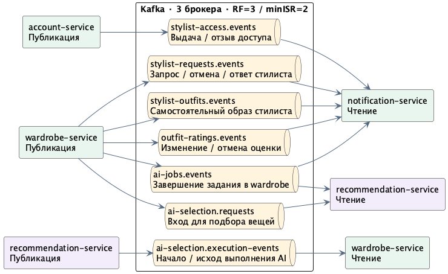
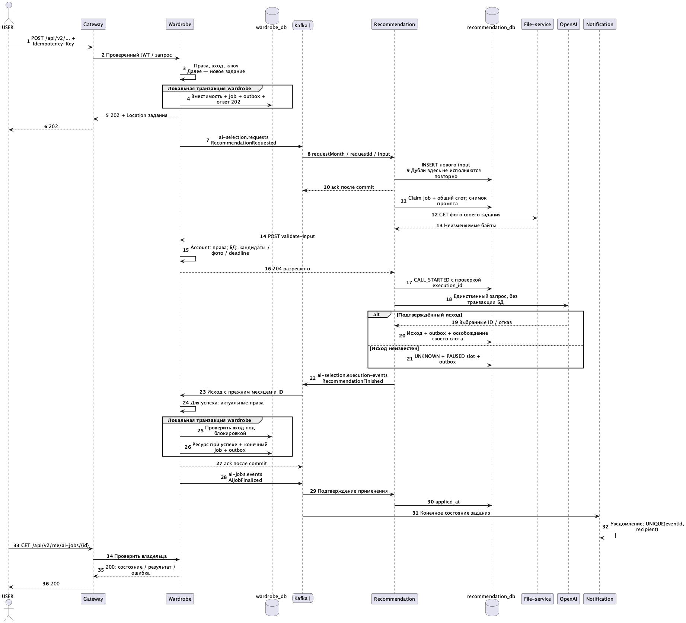

# Сообщения и выполнение AI

Согласованный контракт, `schemaVersion=1`. HTTP v2 и версия сообщения независимы. Producer аутентифицируется в Kafka; неизвестный тип/версия либо невалидное сообщение не выполняется и направляется в диагностическую обработку, без вызова AI.

## Топики

| Топик | Producer → consumer | События |
| --- | --- | --- |
| `stylist-access.events` | account → notification | AccessGranted, AccessRevoked |
| `stylist-requests.events` | wardrobe → notification | StylistRequestCreated, StylistRequestCancelled, StylistRequestAnswered |
| `stylist-outfits.events` | wardrobe → notification | StylistOutfitCreated |
| `outfit-ratings.events` | wardrobe → notification | OutfitRatingChanged, OutfitRatingWithdrawn |
| `ai-jobs.events` | wardrobe → notification, recommendation | AiJobFinalized: задание завершено в wardrobe, результат применён или отклонён |
| `ai-selection.requests` | wardrobe → recommendation | RecommendationRequested: вход для подбора |
| `ai-selection.execution-events` | recommendation → wardrobe | RecommendationStarted, RecommendationFinished: ход и исход выполнения AI |

Имена описывают данные. Топик выполнения AI сообщает о работе recommendation; завершение задания в wardrobe отдельно подтверждает сохранение окончательного состояния и, при успехе, ресурса. Успех модели сам по себе ещё не означает готовый образ. Подтипы одной предметной области различаются по eventType.

Группы подписчиков: `notification-service.events` читает пять топиков событий для уведомлений; `recommendation-service.ai-selection` — запросы подбора; `recommendation-service.ai-jobs` — подтверждения завершения заданий; `wardrobe-service.ai-selection` — события выполнения AI. ACL выдаются на точные имена топиков и групп.

Ключ AI-сообщения — `requestMonth/requestId`; прочих сообщений — тип/ID агрегата. У топиков репликация 3, три партиции, min.insync.replicas=2, retention 7 суток; producer использует acks=all. Политика Kafka не меняет месячное хранение запросов PostgreSQL. Порядок Kafka внутри партиции не заменяет проверки состояния в БД: outbox relay может повторять публикацию. Между разными топиками общего порядка нет. Переход из конечного состояния назад запрещён; поздний Started игнорируется.

Общий envelope: `eventId` (UUID), `eventType`, `schemaVersion`, `occurredAt` (UTC), `aggregateId`, `payload`. Для AI payload содержит `requestId`, `requestMonth` (`YYYY-MM-01`) и `ownerId`. `eventId` не меняется при повторной публикации. Пользовательский Idempotency-Key, JWT, OAuth-токен и S3 credentials в envelope не передаются.

## Вход и результат

RecommendationRequested содержит `goal: OUTFIT|CAPSULE`, `inputVersion: 1`, `acceptedAt`, `startDeadline`, `input`:

- `weather {temperatureC, windSpeedMps, precipitationCode, precipitationName}`;
- `occasion`, `preferredStyle`, три поля `stylePreferences`;
- `requiredItemIds` для замены и список `candidates`;
- кандидат: `itemId`, `name`, `categoryCode`, `categoryName`, `color`, `material`, `photoId`, `fileId`, `contentType`, `sizeBytes`.

Это полный семантический вход **нового** контракта: снимок текста и ссылки на неизменяемые байты. Старый HTTP DTO с `imageBase64` в Kafka/JSONB не переносится. Название будущего образа и ссылка на исходный образ остаются в wardrobe: они не нужны модели для выбора. Значения input, обязательные ID и фотографии не пересобираются из изменившегося гардероба при доставке дубля.

Кандидаты и requiredItemIds сравниваются по ID без учёта порядка; дубли отклоняются. Десятичные числа сравниваются по значению; строки — точно, без trim/смены регистра, nullable-поля нормализуются только по правилам DTO. Файлы равны при одинаковом неизменяемом fileId и согласованных metadata. Сравниваются goal, owner, inputVersion и deadline исходной операции; eventId и время повторной публикации не участвуют. Prompt/model — отдельно сохранённый серверный снимок, не часть пользовательской идентичности. Неизвестная inputVersion не сравнивается по новым правилам автоматически.

INSERT ON CONFLICT и уникальный `(request_month, request_id)` защищают конкурентное создание. После конфликта Kotlin сравнивает сохранённый вход; при различии команда отклоняется как конфликт без изменения/повтора исходного задания. Совпавший дубль не вызывает AI. Конечный результат при необходимости публикуется повторно с тем же eventId и occurredAt: result_event_id и completed_at сохраняются вместе с результатом на весь срок жизни запроса, независимо от очистки опубликованного outbox.

RecommendationFinished содержит `outcome: SUCCEEDED|FAILED|UNKNOWN`. Успех: `itemIds`, `explanation` до 2000 символов; ошибка: разрешённый `errorCode`. Валидация structured output, допустимых ID, обязательных вещей и текста сохраняется. Prompt/version/model фиксируются в БД перед первым запуском и не помещаются в событие результата.

## Транзакции и восстановление

1. Wardrobe проверяет права/вход и существующий ключ. Новый job, outbox и ответ 202 фиксируются одной транзакцией; исходный месяц берётся из времени принятия БД в UTC.
2. Relay отправляет сохранённое сообщение после commit. Recommendation сохраняет запрос до ack Kafka; worker читает БД, а не только память процесса.
3. Worker атомарно получает постоянный слот подключения с новым execution_id и фазой PREPARING. Слот общий с legacy HTTP-адаптером; локальный AtomicBoolean не обеспечивает эту гарантию между репликами.
4. Worker скачивает файлы, затем вызывает validate-input в wardrobe. При разрешении и неистёкшем deadline атомарно переводит свой слот в CALL_STARTED с проверкой execution_id, после commit обращается к OpenAI. Потерявший слот исполнитель не начинает вызов. Транзакция не включает сеть.
5. При известном исходе recommendation сохраняет результат/outbox и освобождает принадлежащий ему слот одной транзакцией. При потере процесса/связи после CALL_STARTED — UNKNOWN, PAUSED и outbox атомарно, без автоматического перезапуска. Даже падение между отметкой и отправкой консервативно считается неопределённым.
6. Wardrobe сверяет пару месяц/ID и получателя. Для успеха проверяет права через account, затем локально блокирует кандидатов, проверяет фото/доступность/обязательные ID и сохраняет ресурс, конечный job и outbox атомарно. FAILED/UNKNOWN завершают job без ресурса.
7. После commit AiJobFinalized сообщает recommendation `applicationOutcome` и тот же месяц/ID. Это подтверждение применяется идемпотентно. Оно означает сохранённое конечное состояние, а не только чтение Kafka.

Временная недоступность account при применении результата не даёт права и не превращается в окончательный отказ: сохраняется ожидание безопасного повтора, без нового AI. Отзыв доступа/удаление исходных данных — конечный FAILED. Ошибка транзакции не подтверждает Kafka; повтор не создаёт второй ресурс. Неожиданный конфликт двух конечных исходов не перезаписывает первый и требует разбора.

Изменение/освобождение слота всегда проверяет execution_id; поздний старый исполнитель не освобождает новый слот и не переписывает конечный исход. До CALL_STARTED подготовку можно возобновить после подтверждённой остановки старого исполнителя и отзыва его владения, если deadline не истёк. После CALL_STARTED автоматического перезахвата по времени нет. Разбор зависшего исполнения и ручное возобновление требуют остановить прежний локальный исполнитель; это всё равно не доказывает остановку провайдера. UNKNOWN остаётся UNKNOWN, новое разрешение касается только будущих вызовов. Для legacy действует тот же протокол слота, хотя фоновая запись запроса ему не требуется.

## Уведомления

| Событие | Получатель | Когда публикуется |
| --- | --- | --- |
| AccessGranted / AccessRevoked | Затронутый стилист | Изменилась строка разрешения |
| StylistRequestCreated / Cancelled | Назначенный стилист | Создание / PENDING → CANCELLED |
| StylistRequestAnswered | Владелец запроса | Ответ и новый образ сохранены одной транзакцией |
| StylistOutfitCreated | Владелец гардероба | Самостоятельный образ стилиста, не ответ на запрос |
| OutfitRatingChanged / Withdrawn | Владелец образа | Голос появился, изменил значение или удалён |
| AiJobFinalized | Владелец задания | SUCCEEDED/FAILED/UNKNOWN сохранены в wardrobe |

Повтор разрешения, replay создания и no-op отмены не публикуют новое событие. Текущее обновление оценки тем же значением сохраняет версию/историю; уведомление подавляется сравнением old/new vote, без изменения этой бизнес-семантики. Ответ стилиста не порождает второе уведомление как самостоятельный образ.

Notification-service атомарно вставляет уведомление с уникальностью `(source_event_id, recipient_id)`; отдельный inbox для этого эффекта не нужен. Kafka подтверждается после commit. Тексты нейтральны и не содержат фотографии, предпочтения или объяснение AI; ссылка не обходит актуальные права. Создаётся одно уведомление на значимый переход без группировки оценок и без напоминаний календаря.
